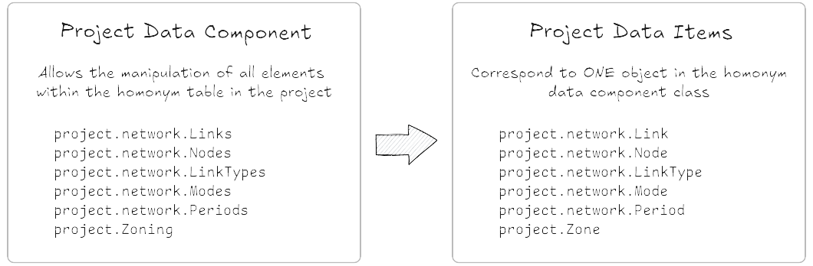

Project Data Components
=======================

In the :ref:`aeq_project_structure` section, we present the structure of an AequilibraE project:
databases, folders, and parameters. In this section, we present the data components of the project,
that is, the data that is presented in the databases.

The components of an AequilibraE project are:

* ``project.about``
* ``project.tables``
* ``project.road``
* ``project.matrices``
* ``project.log()``

The Tables component contains the geo-spatial information of the project, such as links, nodes, and zones, which
can also be manipulated. In the Tables component, there are also
non-geometric classes related to the project network, such as Modes, LinkTypes, and Periods.

Use ``project.road.build_network()`` to copy the tables into an independent routing network,
or ``project.road.build_graph(mode, cost)`` to build a graph directly. The road gateway follows
the project's current scenario; table editing remains on ``project.tables``.

One important thing to observe is that related to each table in Tables,
there is an object with similar name that corresponds to one object in the class. 
Thus ``project.tables.links`` enables the access to manipulate the 'links' table, and each item in 
the items table is a ``Link`` object.

.. toctree::
    :caption: Project Data Components
    :maxdepth: 1

    project_components/components
    project_components/aequilibrae_matrix
