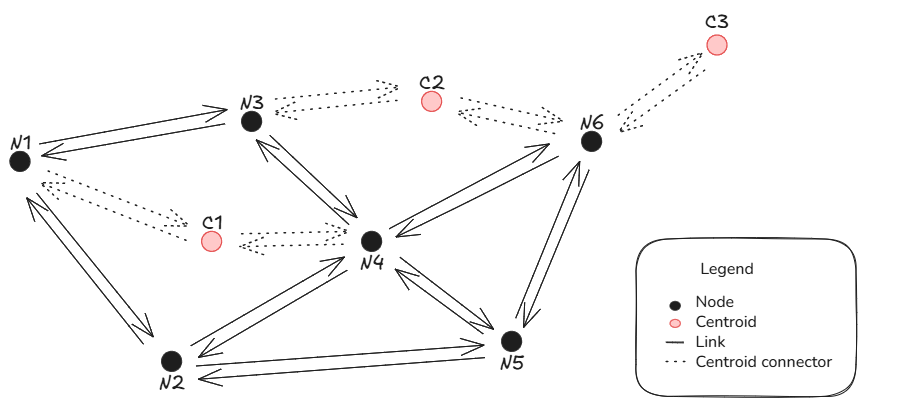

.. _aequilibrae-graphs:

AequilibraE Graphs
==================

A ``Network`` stores source link attributes, modes, centroids, and turn restrictions.
Its ``build_graph()`` method returns an array-backed ``Graph`` for routing.
The graph has fixed topology. Its costs can change without a rebuild.

Graphs from a model
-------------------

A project network can supply the source tables:

.. code-block:: python

    >>> project = create_example(project_path, "coquimbo")
    >>> network = project.network.build()
    >>> graph = network.build_graph('c', cost='distance')

The source tables do not retain project connections. Later changes to project data
do not change this network or its prepared graphs.

To restrict the source data to an area, supply a polygon:

.. code-block:: python

    >>> polygon = Polygon([(-71.35, -29.95), (-71.35, -29.90), (-71.30, -29.90), (-71.30, -29.95), (-71.35, -29.95)])
    >>> network = project.network.build(limit_to_area=polygon)  # doctest: +SKIP

The area filter uses a spatial index. It does not clip links to the polygon boundary.

Source links and directed costs
-------------------------------

The ``network.links`` DataFrame contains one row per physical link.
The ``direction`` field specifies the allowed directions:

* ``1`` permits AB traversal.
* ``-1`` permits BA traversal.
* ``0`` permits both directions.

Direction-specific fields use the suffixes ``_ab`` and ``_ba``.
For example, ``free_flow_time_ab`` and ``free_flow_time_ba`` supply the graph field ``free_flow_time``.
``Network`` preserves column names, and field names are case-sensitive.

``network.field_values(name)`` returns numeric values in physical-link input row order,
with AB before BA for each bidirectional link.
``network.link_ids`` and ``network.directions`` use the same order.
This order includes links that the graph's mode cannot use.

Cost updates and link closures
------------------------------

To close links without a topology change, set their costs to positive infinity:

.. code-block:: python

    >>> costs = network.field_values('distance').copy()
    >>> costs[np.isin(network.link_ids, [123, 975])] = np.inf
    >>> graph.set_costs(costs)

``set_costs()`` requires one value per directed network link, not one value per graph link.
A later call with finite costs can reopen the links.
Negative costs and NaN values are invalid.

For changes to numeric link attributes, edit the source data and build a new graph:

.. code-block:: python

    >>> network.links.loc[network.links.link_type == 'motorway', 'speed_ab'] = 100
    >>> network.links.loc[network.links.link_type == 'motorway', 'speed_ba'] = 100
    >>> graph = network.build_graph('c', cost='distance')

Changes to source attributes do not update an existing graph or calculate
dependent attributes.  For example, a speed change does not automatically
change travel time.  For topology changes (link IDs, endpoints, directions,
added/removed links or row order), construct a new ``Network`` from the revised
link table so its mappings are rebuilt.  Network configuration fields are
fixed, use ``dataclasses.replace()`` to create a validated replacement when
changing modes, centroids or turn restrictions.

Skimming and centroids
----------------------

Skim fields, centroids, and centroid-flow blocking are graph construction options:

.. code-block:: python

    >>> graph = network.build_graph(
    ...     'c', cost='distance',
    ...     centroids=network.centroids[:5],
    ...     skimming=['distance'], block_centroid_flows=False,
    ... )
    >>> skimmer = graph.compute_skims()

Without an explicit centroid array, the graph uses ``network.centroids``.
Centroids must be unique, positive node IDs from the network.
Their order determines the row and column order of skim matrices.
To change centroids or skim fields, build a new graph.

Compact graphs
--------------

A compact graph contracts chains of links. Dead-end removal is an additional,
separate option.  These reductions can reduce routing work for traffic
assignment and centroid-to-centroid skimming.  Both are opt-in when building a
graph, and both require centroids.  ``PathResults.path`` contains local
graph-link indices, and ``get_network_links()`` expands these to physical link
IDs and directions in traversal order.

To enable both reductions:

.. code-block:: python

    >>> compact = network.build_graph('c', cost='distance', compact=True, remove_dead_ends=True)

Traffic assignment enables both reductions by default. Each ``TrafficClass`` can override
``compact`` and ``remove_dead_ends`` through its ``graph_options``.
Congestion calculations still use individual directed network links.

Blocking centroid flows
-----------------------

By default, prepared graphs block paths through intermediate centroids.
For turn-based routing, automatic turn prohibitions prevent traversal between centroid connectors at the same centroid.

Suppose a path from N1 to C3 follows N1 -> N3 -> C2 -> N6 -> C3 in the figure.
Centroid-flow blocking prohibits the connector-to-connector transition at C2.
The path must use another route.

If regular network nodes serve as centroids, consider whether routes must pass through those nodes.
Use ``block_centroid_flows=False`` to permit those routes.

.. seealso::

    * :class:`aequilibrae.paths.network.Network`
    * :class:`aequilibrae.paths.graph.Graph`
    * :class:`aequilibrae.paths.graph.TransitGraph`
