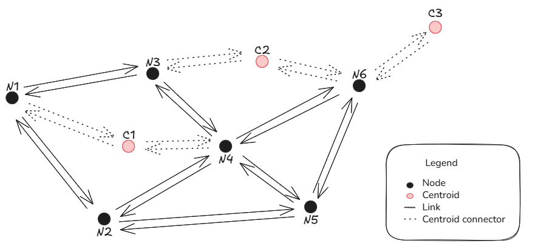

.. _aequilibrae-graphs:

AequilibraE Graphs
==================

A ``Network`` holds source link tables, fields, modes, centroids and turn restrictions.
A prepared graph holds one routing context and mappings back to source links.
Prepared graphs do not retain DataFrames or project connections. The mutable ``Graph`` builder retains DataFrames.

The network dataframe
---------------------

``project.network`` manages the project database.
Its ``build()`` method copies source data into an independent ``Network``.
The optional ``fields``, ``modes`` and ``limit_to_area`` arguments limit that data.

.. code-block:: python

    >>> network = project.network.build(fields=["distance", "free_flow_time"], modes=["c"])

For workflows without a project, ``Network(links)`` accepts a link DataFrame.
The required columns are ``link_id``, ``a_node``, ``b_node`` and ``direction``.
Links in the *network* table (the Pandas representation of the project's *Links* table) are
potentially bi-directional, and the directions allowed for traversal are dictated by the
field *direction*, where -1 and 1 denote only BA and AB traversal respectively and 0 denotes
bi-directionality.
An optional ``modes`` column identifies the modes that can use each link.
Without that column, every mode can use every link.

Direction-specific fields must be coded in fields **_AB** and **_BA**, where the name of
the field in the graph will be equal to the prefix of the directional fields. For example:

The fields *free_flow_travel_time_AB* and *free_flow_travel_time_BA* provide the same
metric (*free_flow_travel_time*) for each of the directions of a link, and the field of
the graph used to set computations (e.g. field to minimize during path-finding, skimming,
etc.) will be *free_flow_travel_time*.
The source table remains available as ``network.links``.
Changes to that table affect new graphs, not existing graphs.

Building a graph
----------------

``build_graph()`` selects the mode, cost field, centroids and skim fields before it prepares routing arrays.
All links in the routing graph are **directed**. Each direction of a bidirectional link becomes a separate routing link.

.. code-block:: python

    >>> graph = network.build_graph(
    ...     mode="c", cost="distance", skimming=["distance", "free_flow_time"],
    ...     block_centroid_flows=False,
    ... )
    >>> result = graph.compute_path(1, 17)
    >>> result.path_nodes
    >>> result.path

``path_nodes`` contains external node IDs. ``path`` contains source link IDs.
``path_link_directions`` identifies each link's travel direction.
``milepost`` contains cumulative costs, including turn penalties.

For a single graph, ``project.network.build_graph(...)`` combines the source load and graph preparation.
For several graphs or assignments, an explicit ``Network`` can reuse the source data.
Both forms work independently of the project after the source load.

Full and compact graphs
-----------------------

A graph contains either full or compact routing topology, not both.
Full graphs are the default and support paths between arbitrary network nodes.
``compact=True`` prepares topology for centroid-based computations.
Traffic assignment builds compact graphs internally.

The purpose of the compressed graph is to optimize its performance for the more recurrent
and time consuming computations in modelling, which are traffic assignment and skimming.

The key characterist we can leverage to optimize performance for these operations is that paths
are computed only between centroids, therefore two forms of compression are possible:

1. Topological simplification
2. Dead end removal

Topological simplification consists in creating a topological equivalent of the graph
by contracting sequences of links between intersections (extra nodes). These links are often common
in long links.

It is important to note that computations that cannot be handled at the compressed level without 
loss of fidelity, for example the computation of congestion during traffic assignment, is done 
at the uncompressed (graph) level, but we still extract the full benefits of the compression 
at the path-computation stage, which is the most time-consuming portion of assignment.

Dead end removal is an additional procedure, that consists in removing dead ends and fish 
spines from the network. For those
not familiar with the term, a fish spine is a road network with multiple smaller streets
branching off from it, often leading to dead ends or cul-de-sacs, creating a pattern that
resembles a fish spine.

Whilst it's easy for humans to ignore dead ends when planning a route, the same cannot be
said for computers. Dead end removal is done based on the observation that in a graph with
non-negative weights a dead end will only ever appear in the results of a short(est) path if
the origin or destination is present within that dead end.

Dead end removal is applied before topological simplification and results in a distinctive
network, topologically speaking. However, all centroids are preserved. More about dead end removal can be
found `at this blog post <https://www.outerloop.io/blog/20240205_dead_end_removal/>`_.
Centroids and nodes that control turn restrictions remain in the graph.
The expansion mapping converts compact paths and loads back to source links.

.. code-block:: python

    >>> graph = network.build_graph(
    ...     "c", "distance", centroids=np.array([1, 17]), compact=True,
    ...     skimming=["distance"], block_centroid_flows=False,
    ... )
    >>> skims = graph.compute_skims().results.skims

Leveraging topological simplification
-------------------------------------

Topological simplification is a powerful tool that may want to be leveraged for other purposes.
As such, we make it available for users to access it.

For this purpose, the user should be explicit in not removing dead ends from the graph, as that will
result in simplification beyond pure topological simplification.

The mutable ``Graph`` builder remains available for this low-level workflow.

.. code-block:: python

    >>> from aequilibrae.paths import Graph
    >>> project = create_example(project_path, "coquimbo")
    >>> network = project.network.build()
    >>> graph = Graph()
    >>> graph.network = network.links
    >>> graph.prepare_graph(np.array([13, 169, 2197, 28561, 37123], np.int32), remove_dead_ends=False)

Topology changes
----------------

Modes, centroids, skim fields and turn restrictions are fixed for each graph.
A topology change requires a new graph from the network.

.. code-block:: python

    >>> graph = network.build_graph(
    ...     "c", "distance", centroids=np.array([1, 17]),
    ...     turn_restrictions=turns, allow_uturns=False,
    ... )

When working with very large networks, it is possible to filter the database to a small
area for computation by providing a polygon that delimits the desired area, instead of
selecting the links for deletion. The selection of links and nodes is limited to a spatial
index search, which is very fast but not accurate.

.. code-block:: python

    >>> polygon = Polygon([(-71.35, -29.95), (-71.35, -29.90), (-71.30, -29.90), (-71.30, -29.95), (-71.35, -29.95)])
    >>> network = project.network.build(limit_to_area=polygon) # doctest: +SKIP

More sophisticated graph editing is also possible, but it is recommended that
changes to be made in the network DataFrame. For example:

.. code-block:: python

    # We can add fields to our network
    >>> network.links["link_type"] = project.network.links.data["link_type"]

    # And manipulate them
    >>> network.links.loc[network.links.link_type == "motorway", "speed_ab"] = 100
    >>> network.links.loc[network.links.link_type == "motorway", "speed_ba"] = 100

Skimming settings
-----------------

Skim fields are supplied when building the graph. There are no limits (other than memory) to the number
of fields that can be skimmed.

.. code-block:: python

    >>> graph = network.build_graph("c", "distance", skimming=["distance", "travel_time"])

Setting centroids
-----------------

The ``centroids`` argument selects the nodes used as centroids in a new graph.
This brings the advantage of allowing the user to perform assignment of partial
matrices, matrices of travel between arbitrary network nodes and to skim the network
for an arbitrary number of centroids in parallel, which can be useful when using
AequilibraE as part of more general analysis pipelines. As seen above, this is also
necessary when the network has been manipulated in memory.

**When setting regular network nodes as centroids, take care when enabling
centroid-flow blocking.**

.. code-block:: python

    >>> graph = network.build_graph(
    ...     "c", "distance", centroids=np.array([13, 169, 2197, 28561, 37123], np.int32),
    ...     block_centroid_flows=False,
    ... )

Cost changes and link closures
------------------------------

``Graph.set_costs()`` changes costs without changing topology.
The array uses directed network links in ascending link-ID and direction order.
``network.link_ids`` and ``network.directions`` describe that order.
Positive infinity closes a link direction to routing.

.. code-block:: python

    >>> costs = network.field_values("distance").copy()
    >>> costs[np.isin(network.link_ids, [123, 975])] = np.inf
    >>> graph.set_costs(costs)

Existing path results retain their own cost snapshot.
New searches use the updated costs.

Blocking centroid flows
-----------------------

When using AequilibraE Graph, it is possible to configure whether paths may pass
through centroid connector turns. In current versions, enabling blocked centroid
flows applies automatic turn prohibitions between centroid connectors that meet at
the same node (when a centroid has multiple connectors).

Suppose one wants to compute the shortest path between node N1 and centroid C3 in the
figure below. An initial path guess would be N1 -> N3 -> C2 -> N6 -> C3 because all
links are bi-directional. However, when blocked centroid flows are enabled, the
connector-to-connector transition at C2 is prohibited, so that intermediary centroid
traversal is prevented.

For ordinary network nodes used as centroids, ``block_centroid_flows=False`` permits through travel.

.. seealso::

    * :class:`aequilibrae.paths.network.Network`
    * :class:`aequilibrae.paths.graph.Graph`
    * :class:`aequilibrae.paths.graph.TransitGraph`
