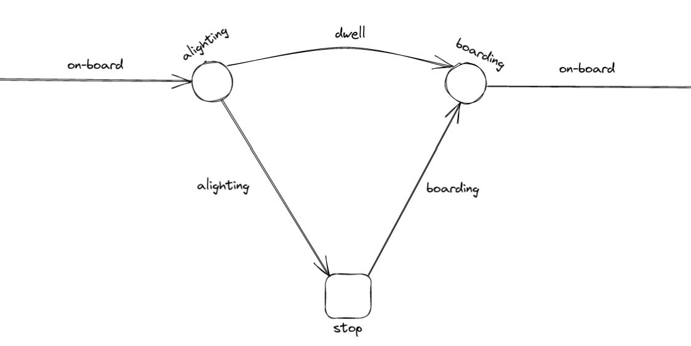
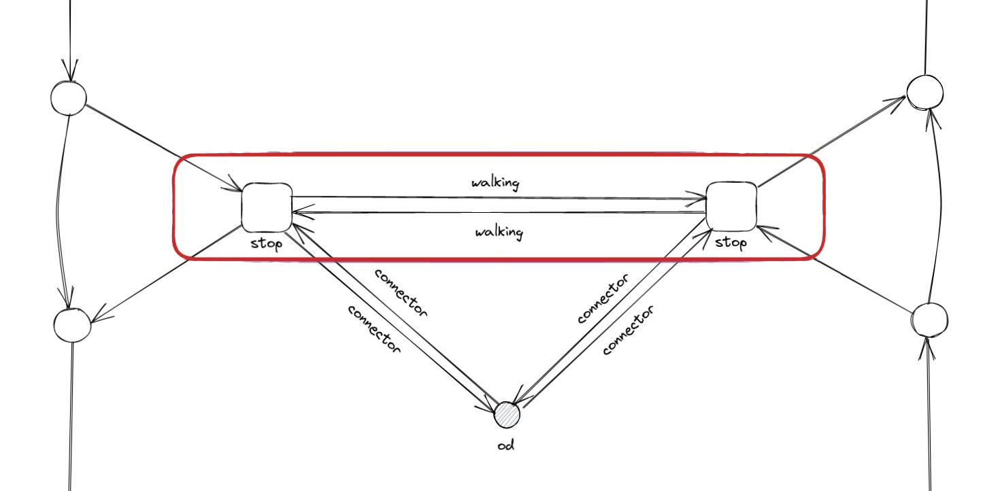
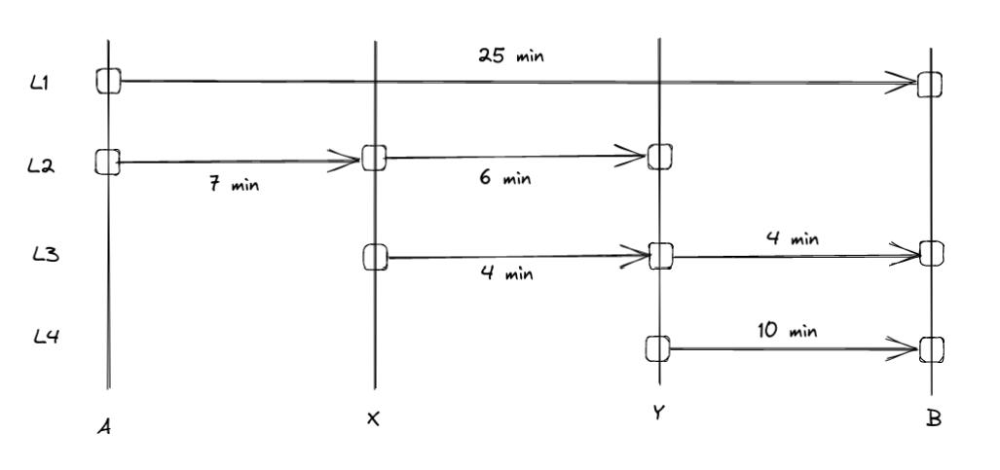

.. _transit_graph:

Transit assignment graph
========================

In this section, we describe a graph structure for a transit network used for static, link-based,
frequency-based assignment. Our focus is the classic algorithm *optimal strategies* by Spiess and
Florian (1989) [1]_.

Let's start by giving a few definitions:

- **transit**: according to `Wikipedia <https://en.wikipedia.org/wiki/Public_transport>`_, it is a
  *"system of transport for passengers by group travel systems available for use by the general public 
  unlike private transport, typically managed on a schedule, operated on established routes, and that
  charge a posted fee for each trip."*

- **transit network**: a set of transit lines and stops, where passengers can board, alight or 
  change vehicles.

- **assignment**: distribution of the passengers (demand) on the network (supply), knowing that 
  transit users attempt to minimize total travel time, time or distance walking, time waiting, 
  number of transfers, fares, etc…

- **static assignment**: assignment without time evolution. Dynamic properties of the flows, such 
  as congestion, are not well described, unlike with dynamic assignment models.

- **schedule-based approach**: in this approach, distinct vehicle trips are represented by
  distinct links. We can see the associated network as a time-expanded network, where the third 
  dimension would be time.

- **frequency-based** (or **headway-based**) **approach**: unlike with the schedule-based approach, 
  the schedules are averaged in order to get line frequencies.
   
- **link-based approach**: in this approach, the assignment algorithm is not evaluating paths, or
  any aggregated information besides attributes stored by nodes and links. In the present case, 
  each link has an associated cost (travel time, in :math:`s`) and frequency (in :math:`1/s`).

Elements of a transit network
-----------------------------

These are the elements required to describe an assignment graph.

* **Transit stops and stations**: transit stops are points where passenger can board, alight or change
  vehicles. Also, they can be part of larger stations. In the illustratation below, two distinct
  stops ('A' and 'B') are highlighted, and they are both affiliated with the same station (depicted 
  in red).

  .. image:: ../_images/transit/transit_graph_stops_stations.png
     :scale: 60%
     :align: center
     :alt: transit stops and stations

* **Transit lines**: a transit line is a set of services that may use different routes, decomposed 
  into segments.

* **Transit routes**: a route is described by a sequence of stop nodes. We assume here the routes 
  to be directed. For example, we can take a simple case with 3 stops. In this case, the 'L1' line
  is made of two different routes: 'ABC' and 'CBA'.

  .. image:: ../_images/transit/transit_graph_routes_1.png
     :scale: 60%
     :align: center
     :alt: transit routes 1

  A route can present various configurations, such as a partial route at a given moment of the day
  ('AB'), a route with an additional stop ('ABDC'), a route that does not stop at a given stop ('AC').

  .. image:: ../_images/transit/transit_graph_routes_2.png
     :scale: 60%
     :align: center
     :alt: transit routes 2

  Lines can also be decomposed into multiple sub-lines, each representing distinct routes. For the 
  given example, we may have several sub-lines under the same commercial line (L1).

  .. table::
     :align: center
     :width: 40%
 
     +---------+-----------------+---------------+-------------+
     | Line ID | Commercial Name | Stop Sequence | Headway (s) |
     +=========+=================+===============+=============+
     | L1_a1   | L1              | ABC           | 600         |
     +---------+-----------------+---------------+-------------+
     | L1_a2   | L1              | ABDC          | 3,600       |
     +---------+-----------------+---------------+-------------+
     | L1_a3   | L1              | AB            | 3,600       |
     +---------+-----------------+---------------+-------------+
     | L1_a4   | L1              | AC            | 3,600       |
     +---------+-----------------+---------------+-------------+
     | L1_b1   | L1              | CBA           | 600         |
     +---------+-----------------+---------------+-------------+

  Associated with each sub-line, the headway corresponds to the mean time range between consecutive
  vehicles. The assignment uses the line frequency: the number of distinct departures of the
  sub-line in the period, divided by the period length.

* **Line segments**: a line segment represents a portion of a transit line between two consecutive 
  stops. Using the example line 'L1_a1', we derive two distinct line segments:

  .. table::
    :align: center
    :width: 40%

    +----------+---------------+-------------+-------------------+--------------+
    | Line ID  | Segment Index | Origin Stop | Destination Stop  | Travel Time  |
    +==========+===============+=============+===================+==============+
    | L1_a1    | 1             | A           | B                 | 300          |
    +----------+---------------+-------------+-------------------+--------------+
    | L1_a1    | 2             | B           | C                 | 600          |
    +----------+---------------+-------------+-------------------+--------------+

Note that a travel time is included for each line segment, serving as another link attribute used
by the assignment algorithm. AequilibraE takes it as the mean scheduled run time of the segment.

* **Transit Assignment Zones**: transit assignment zones correspond to the partition of
  the network area. The illustration below presents 4 non-overlapping zones, whose demand
  is expressed as a number of trips from each zone to every other zone, forming a 4 x 4 
  Origin-Destination (OD) matrix.

  .. image:: ../_images/transit/transit_graph_zones.png
    :scale: 60%
    :align: center
    :alt: transit zones

* **Connectors**: connectors are special network nodes that facilitate the connection between supply 
  and demand.

  .. image:: ../_images/transit/transit_graph_connectors.png
    :scale: 60%
    :align: center
    :alt: transit connectors

The assignment graph
--------------------

The transit network is used to generate a graph with specific nodes and links used to model the
transit process. Various link types and node categories play crucial roles in this representation.

.. table::
    :align: center
    :width: 40%

    +----------------+-------------+
    | Link types     | Node types  |
    +================+=============+
    | On-board       | Stop        |
    +----------------+-------------+
    | Boarding       | Boarding    |
    +----------------+-------------+
    | Alighting      | Alighting   |
    +----------------+-------------+
    | Dwell          | Origin      |
    +----------------+-------------+
    | Outer transfer | Destination |
    +----------------+-------------+
    | Connector      | OD          |
    +----------------+             |
    | Walking        |             |
    +----------------+-------------+

To illustrate, consider the anatomy of a simple stop (figure below). Each line segment is associated
with a boarding, an on-board and an alighting link, and passengers who stay on board at a stop use
its dwell link. Boarding links are the only links where passengers wait.

A transfer between two lines at the same stop alights to the stop node and boards again from it, so
every boarding of a trip is counted on a boarding link. The boarding split at a stop then depends on
the destination, and line-to-line transfer counts come from the assignment rather than from
dedicated links.

Walking links connect *stop* nodes within a station, while *connector* links connect the zone
centroids (OD nodes) to *stop* nodes. Connectors that connect OD to *stop* nodes allow passengers to
access the network, while connectors in the opposite direction allow them to egress. Outer transfer
links also connect the stops of a station, from one stop node to another.

Every link runs from its tail, ``a_node``, to its head, ``b_node``. The graph holds physical
attributes only, and the assignment class turns them into the cost and frequency of each link (see
`Physical attributes and costing`_ below). The table below summarizes link characteristics based on
link types, with the costing that ``TransitClass`` uses by default:

.. table::
   :align: center
   :width: 60%

   +----------------+-----------------+-----------------+--------------------------+------------------+
   | Link Type      | From node type  | To node type    | Cost                     | Frequency        |
   +================+=================+=================+==========================+==================+
   | on-board       | boarding        | alighting       | run time                 | :math:`\infty`   |
   +----------------+-----------------+-----------------+--------------------------+------------------+
   | boarding       | stop            | boarding        | half the dwell           | line frequency   |
   +----------------+-----------------+-----------------+--------------------------+------------------+
   | alighting      | alighting       | stop            | half the dwell +         | :math:`\infty`   |
   |                |                 |                 | alighting penalty        |                  |
   +----------------+-----------------+-----------------+--------------------------+------------------+
   | dwell          | alighting       | boarding        | dwell                    | :math:`\infty`   |
   +----------------+-----------------+-----------------+--------------------------+------------------+
   | outer transfer | stop            | stop            | walking time             | :math:`\infty`   |
   +----------------+-----------------+-----------------+--------------------------+------------------+
   | connector      | origin or stop  | stop or         | walking time             | :math:`\infty`   |
   |                |                 | destination     |                          |                  |
   +----------------+-----------------+-----------------+--------------------------+------------------+
   | walking        | stop            | stop            | walking time             | :math:`\infty`   |
   +----------------+-----------------+-----------------+--------------------------+------------------+

The run time is the mean scheduled time between consecutive stops of the trips of a line in the
period, and the dwell is the mean scheduled time between arrival and departure at a stop. For
example, there can be 10 minutes connection between stops in a large transit station.

Links carry the following attributes:

- ``line_id``: for on-board, boarding, alighting and dwell links.

- ``line_seg_idx``: the line segment index for boarding, on-board, alighting and dwell links.

- ``stop_id``: for boarding, alighting and dwell links, and the stop of connectors.

- ``segment_id``: the physical element of the link: ``pattern_id:seq`` for line links, the stop for
  connectors and ``from_stop:to_stop`` for walks between stops.

- ``run_time``, ``dwell_time``, ``walk_distance``, ``walk_time``, ``headway``, ``trip_count``,
  ``line_freq`` and ``capacity``: the physical attributes described below.

Assignment graph example - Based on Spiess and Florian (1989)
~~~~~~~~~~~~~~~~~~~~~~~~~~~~~~~~~~~~~~~~~~~~~~~~~~~~~~~~~~~~~

This illustrative example is taken from Spiess and Florian (1989) [1]_.

The following figure presents the travel times for each line.

We have the following four distinct line characteristics:

.. table::
   :align: center
   :width: 40%

   +---------+-------+---------------+-----------------+
   | Line ID | Route | Headway (min) | Frequency (1/s) |
   +=========+=======+===============+=================+
   | L1      | AB    |          12   |     0.001388889 |
   +---------+-------+---------------+-----------------+
   | L2      | AXY   |          12   |     0.001388889 |
   +---------+-------+---------------+-----------------+
   | L3      | XYB   |          30   |     0.000555556 |
   +---------+-------+---------------+-----------------+
   | L4      | YB    |           6   |     0.002777778 |
   +---------+-------+---------------+-----------------+

Passengers aim to travel from A to B, prompting the division of the network area into two distinct
zones: TAZ 1 and TAZ 2. The assignment graph associated with this network encompasses 22 links.
Line 2 passengers transferring at Y alight to stop Y (link 12) and board line 3 or line 4 from it
(links 15 and 16).

.. table::
   :align: center
   :width: 60%

   +---------+------------------+---------+-------------------+-------------------+------+--------------+
   | Link ID | Link Type        | Line ID | From              | To                | Cost |    Frequency |
   +=========+==================+=========+===================+===================+======+==============+
   |       1 | access_connector |         | TAZ 1             | stop A            |    0 |:math:`\infty`|
   +---------+------------------+---------+-------------------+-------------------+------+--------------+
   |       2 | boarding         |      L1 | stop A            | L1 boarding A     |    0 |  0.001388889 |
   +---------+------------------+---------+-------------------+-------------------+------+--------------+
   |       3 | boarding         |      L2 | stop A            | L2 boarding A     |    0 |  0.001388889 |
   +---------+------------------+---------+-------------------+-------------------+------+--------------+
   |       4 | on-board         |      L1 | L1 boarding A     | L1 alighting B    | 1500 |:math:`\infty`|
   +---------+------------------+---------+-------------------+-------------------+------+--------------+
   |       5 | on-board         |      L2 | L2 boarding A     | L2 alighting X    |  420 |:math:`\infty`|
   +---------+------------------+---------+-------------------+-------------------+------+--------------+
   |       6 | alighting        |      L2 | L2 alighting X    | stop X            |    0 |:math:`\infty`|
   +---------+------------------+---------+-------------------+-------------------+------+--------------+
   |       7 | dwell            |      L2 | L2 alighting X    | L2 boarding X     |    0 |:math:`\infty`|
   +---------+------------------+---------+-------------------+-------------------+------+--------------+
   |       8 | boarding         |      L2 | stop X            | L2 boarding X     |    0 |  0.001388889 |
   +---------+------------------+---------+-------------------+-------------------+------+--------------+
   |       9 | boarding         |      L3 | stop X            | L3 boarding X     |    0 |  0.000555556 |
   +---------+------------------+---------+-------------------+-------------------+------+--------------+
   |      10 | on-board         |      L2 | L2 boarding X     | L2 alighting Y    |  360 |:math:`\infty`|
   +---------+------------------+---------+-------------------+-------------------+------+--------------+
   |      11 | on-board         |      L3 | L3 boarding X     | L3 alighting Y    |  240 |:math:`\infty`|
   +---------+------------------+---------+-------------------+-------------------+------+--------------+
   |      12 | alighting        |      L2 | L2 alighting Y    | stop Y            |    0 |:math:`\infty`|
   +---------+------------------+---------+-------------------+-------------------+------+--------------+
   |      13 | alighting        |      L3 | L3 alighting Y    | stop Y            |    0 |:math:`\infty`|
   +---------+------------------+---------+-------------------+-------------------+------+--------------+
   |      14 | dwell            |      L3 | L3 alighting Y    | L3 boarding Y     |    0 |:math:`\infty`|
   +---------+------------------+---------+-------------------+-------------------+------+--------------+
   |      15 | boarding         |      L3 | stop Y            | L3 boarding Y     |    0 |  0.000555556 |
   +---------+------------------+---------+-------------------+-------------------+------+--------------+
   |      16 | boarding         |      L4 | stop Y            | L4 boarding Y     |    0 |  0.002777778 |
   +---------+------------------+---------+-------------------+-------------------+------+--------------+
   |      17 | on-board         |      L3 | L3 boarding Y     | L3 alighting B    |  240 |:math:`\infty`|
   +---------+------------------+---------+-------------------+-------------------+------+--------------+
   |      18 | on-board         |      L4 | L4 boarding Y     | L4 alighting B    |  600 |:math:`\infty`|
   +---------+------------------+---------+-------------------+-------------------+------+--------------+
   |      19 | alighting        |      L1 | L1 alighting B    | stop B            |    0 |:math:`\infty`|
   +---------+------------------+---------+-------------------+-------------------+------+--------------+
   |      20 | alighting        |      L3 | L3 alighting B    | stop B            |    0 |:math:`\infty`|
   +---------+------------------+---------+-------------------+-------------------+------+--------------+
   |      21 | alighting        |      L4 | L4 alighting B    | stop B            |    0 |:math:`\infty`|
   +---------+------------------+---------+-------------------+-------------------+------+--------------+
   |      22 | egress_connector |         | stop B            | TAZ 2             |    0 |:math:`\infty`|
   +---------+------------------+---------+-------------------+-------------------+------+--------------+

With waits of half a headway (``TransitCosting(headway_fraction=0.5, alighting_penalty=0)``), the
optimal strategy from A to B boards whichever of lines 1 and 2 comes first, and line 2 passengers
board whichever of lines 3 and 4 comes first at Y. Its expected travel time is 27.75 minutes: 3.0
minutes of first wait, 1.25 minutes of transfer wait and 23.5 minutes in vehicle, with 1.5 boardings
and 0.5 transfers.

Physical attributes and costing
-------------------------------

``TransitGraphBuilder`` builds the physical supply of one period, from the complete trips that the
period includes. Each trip belongs to the period by a trip-level rule, ``trip_inclusion``: by
default, the trip belongs to the period its first departure falls in. Times count seconds from the
start of the GTFS service day, so trips and periods may run past ``24:00:00``. The links hold:

- ``run_time``: the mean scheduled run time of on-board links;
- ``dwell_time``: the mean scheduled dwell at the stop of dwell, boarding and alighting links;
- ``walk_distance`` and ``walk_time``: the geodesic walking distance of connectors and walks between
  stops, and that distance over the builder's ``walking_speed``;
- ``headway``: the scheduled headway of a line, the spread of its departures over the gaps between
  them, on boarding links;
- ``trip_count``: the trips of a line in the period, on boarding links;
- ``line_freq``: the line's distinct departures over the period length on boarding links, which is
  the frequency the assignment waits with, and :math:`\infty` on every other link;
- ``capacity``: the capacity of all the period's trips on on-board links.

The graphs saved to ``public_transport.sqlite`` store these attributes, and no costs.

A ``TransitClass`` evaluates its ``TransitCosting`` into a cost and a frequency for every link, and
writes them to the ``trav_time`` and ``freq`` fields of its ``TransitGraph``. The costing holds the
headway fraction :math:`\alpha` (the expected wait as a fraction of the headway, ``0.5`` by default),
the wait weight :math:`\omega`, the alighting penalty, the shares of the scheduled dwell perceived
when boarding and alighting, and the weights of access, egress and walking times. Classes that share
a graph each keep their own costing.

.. code-block:: python

    from aequilibrae.paths import TransitClass, TransitCosting

    builder = transit.create_graph(with_walking_edges=False)
    graph = builder.to_transit_graph()

    costing = TransitCosting(headway_fraction=0.5, wait_weight=2.0, alighting_penalty=300.0)
    pt = TransitClass("pt", graph, demand, costing=costing)

Transit graph specificities in AequilibraE
------------------------------------------

The graph creation process in AequilibraE incorporates several edge types to capture the nuances of
transit networks. Notable distinctions include:

* Connectors

  - access connectors: directed from origin nodes to stops
  - egress connectors: directed from stops to destination nodes

  Every stop connects to its nearest zone (``nearest_neighbour``) or to the zones whose region
  overlaps it (``overlapping_regions``), and every zone connects to at least its nearest stop.
  Candidates are searched in ``projected_crs``, by default the UTM zone of the stops, and distances are
  geodesic. ``distance_upper_bound`` drops connectors longer than the bound, and
  ``max_connectors_per_zone`` keeps each zone's nearest stops.

* Transfer edges

  - outer transfer: connect the distinct stops of a parent station, from stop to stop

* Origin and destination nodes

  - origin nodes: represent the starting point of passenger trips
  - destination nodes: represent the end point of passenger trips

Users can customize these features using boolean parameters:

- ``with_walking_edges``: create walking edges between the stops of a station

- ``with_outer_stop_transfers``: create outer transfer edges between the stops of a station. A pair
  of stops gets one edge, an outer transfer when both options are set.

- ``blocking_centroid_flows``: duplicate OD nodes into unconnected origin and destination nodes to
  block centroid flows. Flows start from an origin node and end at a destination node.
  It is not possible to use an egress connector followed by an access connector in the middle of a
  trip.

``with_inner_stop_transfers`` is deprecated and has no effect, since transfers at a stop use the stop
node. This leads to these possible edge types:

- on-board
- boarding
- alighting
- dwell
- access_connector
- egress_connector
- outer_transfer
- walking

References
----------

.. [1] Spiess, H. and Florian, M. (1989) "Optimal strategies: A new assignment model for transit networks". 
       Transportation Research Part B: Methodological, 23(2), 83-102. 
       Available in: https://doi.org/10.1016/0191-2615(89)90034-9
