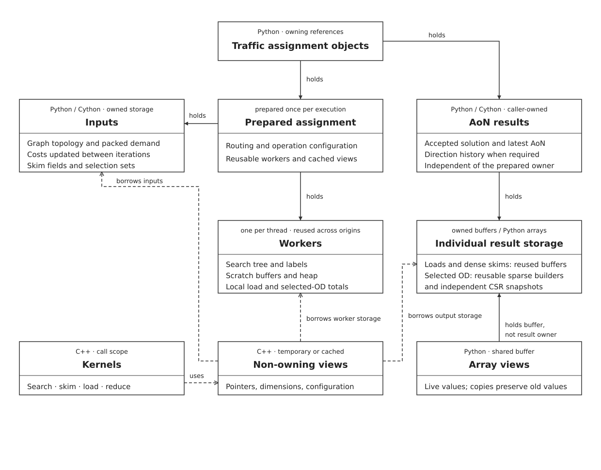

:orphan:

.. _internals:

AequilibraE Internals
---------------------

This section aims to describe the internals of AequilibraE in such a way that
contributors can quickly get up to speed.

.. note::
   The goal of this page is not to comprehensive document all aspects, just the
   guiding principles and patterns.

Philosophy
~~~~~~~~~~

AequilibraE is first and foremost a Python library that is composed of
Cython/C++ kernels for performance critical operations. We should aim to expose
things when appropriate to Python. Overarching control flow and all user
options should be in Python. We accept data from, and provide results back as
Python objects.

Role of Cython and C++
^^^^^^^^^^^^^^^^^^^^^^

Despite having an ever increasing amount of C++ code, AequilibraE is not a C++
library and we should not architecture it as such. Nor is it a Cython
library. In the past we have written core algorithms in Cython (e.g. AoN, route
choice set generation), and with this we got 90% of the performance from static
typing and access to C++ data structures and the ease of writing in a more
familiar looking language. However, for more complicated procedures, Cython has
proven to require more effort to write in and reason about than other
languages. Part of this is due to the nature of C++ code generation and less
mature tooling for Cython specifically. With the rise of LLMs, it became clear
they performed significantly better in other languages than in Cython, and so
with the development of AequilibraE 2.0 came a push to move critical algorithms
into C++ with Cython serving best as the translation tool between Python and
C++.

Cython provides excellent access to both C++ structures and Python objects, it
provides seamless conversion between particular types and allows the storage
and usage of C++ procedures. It provides convenient access to OpenMP threading
and the ability to release the GIL when operating outside of the Python
interpreter. For these reasons Cython is best suited in between Python and C++.

C++ code best serves our needs with small, high performance, procedures
(kernels). Being plain C++ with no Python inter-op, it allows us to ignore the
restrictions imposed by Python and operate on data as any other C++ code
would. We then use Cython to invoke and translate between the C++ kernels and
the user facing Python.

Common patterns
~~~~~~~~~~~~~~~

   Traffic assignment ownership and lifetimes.

Allocation and ownership
^^^^^^^^^^^^^^^^^^^^^^^^

We generally allocate memory in Cython and pass pointers to C++. This lets
Python manage the lifetime of the data, while the C++ code can work with it
without knowing anything about Python or NumPy.

As a rule, memory can be passed down, but should not be passed up. Passing
Cython-allocated buffers to C++ is fine but we should almost never expose
C++-allocated memory as buffers in Cython or Python objects, as this makes it
much harder to get lifetimes right and avoid manual memory management. If we
need to return data held in C++ containers, copying it into Python-managed
storage is usually the simpler choice.

The ``array`` helper in ``src/aequilibrae/utils/cython/array_allocations.pyx``
allocates contiguous, C-ordered buffers. It is specialised on the element type
and can be assigned directly to a typed memoryview:

.. code-block:: cython

   from aequilibrae.utils.cython.array_allocations cimport array, array_pointer

   cdef double[:, ::1] state_loads = array[double]((state_count, class_count), True, 0)
   cdef size_t[::1] predecessors = array[size_t](state_count, True, <size_t>-1)
   cdef size_t *predecessor_data = array_pointer(predecessors)

The arguments are the shape, whether to fill the buffer, and the fill value.
By default we fill with zeros. We can skip this by passing false when we know
we will overwrite every element before reading it.

Storing the memoryview on an extension type object keeps the underlying buffer
from being garbage collected for as long as that object is alive and holds the
memoryview. We do not need to manage a separate ``malloc`` and ``free``. This
also means that, in normal use, calling ``.view()`` on the object cannot give
us a pointer to memory that has already been freed.

However, nothing stops the C+ view from living longer than the extension type
object and being left with dangling pointers.  We should therefore make views
when we need them and avoid storing them unless there is a good reason to do
so. If we do store a view, we must also keep its parent object alive and make
sure its buffers are not replaced.

We can also hold memoryviews of arrays supplied by the caller rather than
allocating our own. C++ containers are useful for things like heaps and growing
lists of sparse entries, but their storage should stay internal.
``SearchWorkspace``, for example, creates a C++ heap with ``new`` and deletes
it in ``__dealloc__``. ``SparseMatrixBuilder`` uses a ``unique_ptr`` to manage
its COO vectors and copies their contents when returning arrays to Python.

Cython owners and C++ views
^^^^^^^^^^^^^^^^^^^^^^^^^^^

A common route from Python to a kernel is:

.. code-block:: text

   Python call -> Cython cdef class -> .view() -> C++ struct -> C++ function

The extension type handles the Python side: checking inputs, keeping the data
alive, and providing methods and properties. Its ``cdef view`` method puts the
pointers, sizes, and options needed by the kernel into a small C++ struct.

The C++ types and functions are declared to Cython in ``.pxd`` files. We often
prefix their Cython names with ``Cpp`` to distinguish them from the extension
types. For example, ``CppMutableSearchResults`` names the C++
``MutableSearchResults`` struct, while ``SearchResults`` is the Cython class.
The structs and kernels themselves are defined in C++ headers.

We can see this in ``dijkstra.pyx``. After checking that the context, query,
results, and workspace have matching dimensions, it calls down to C++ like this:

.. code-block:: cython

   cdef CppSearchQuery cpp_query = query.view()
   cdef CppMutableSearchResults[double] cpp_results = results.view()
   cdef CppSearchWorkspace[double] cpp_workspace = workspace.view()
   with nogil:
       cpp_dijkstra(context.view(), cpp_query, cpp_results, cpp_workspace)

C++ writes straight into the buffers held by ``results``. We can then return
that same Python object without copying anything back.

Views can have convenience methods such as ``reset()``, ``origin()``, and
``read_view()``. They borrow subsets of slices of the data of their parent
structs.

Most ``view()`` methods just assemble a struct and can be ``noexcept nogil``
but if a method can raise an exception, for instance when the requested dtype
doesn't match the fused type, we need to declare that method as ``except *``.

.. note::

   ``nogil except *`` do not require the GIL to execute, but must acquire the
   GIL after to check for exceptions. ``noexcept`` should not be used just to
   avoid exception checks, as long as it's not in a hot loop it should be
   fine. Cython warns about this but an easy trap to fall into.

``PreparedAoN`` is one place where we do store views to reuse them. It keeps
the demand, contexts, and ``_AoNWorker`` objects alive alongside those views.
Each worker holds its search results, workspace, and outputs.

Typed views and dispatch
^^^^^^^^^^^^^^^^^^^^^^^^

For matrices, we also need to tell Cython which element type to use. We do this
with ``.view[float]()`` or ``.view[double]()``. This selects a fused-type
specialisation so we require that the type must already match the matrix's
dtype. For example:

.. code-block:: cython

   cdef CppSparseMatrix[double] matrix_view = demand.view[double]()
   cdef CppSparseMatrixOriginView[double] row = matrix_view.origin(origin)

Here ``demand`` is a typed ``SparseMatrix`` object. The ``view`` method returns
``CppSparseMatrix[cython.floating]`` and has a default argument,
``cython.floating _type=0``. We don't use this argument's value, instead we use
it to make Cython generate the float and double versions of the method.

Dense matrices store values in ``[origins, destinations, fields]`` order.
Sparse matrices use one CSR pattern for all fields, with values stored in
``[stored positions, fields]`` order. In both cases the fields for an OD pair
sit next to each other in memory. ``origin()`` is similar to ``view()`` in that
it gives us a view of one row without creating a new object for it or copying
data.

In ``aon.pyx`` we also need to choose between routing and demand types at
runtime. ``PreparedAoN.run`` checks whether routing is node-based or turn-based
and whether demand is dense or sparse, then calls the appropriate version of
``assign_origins``. Cython's fused types and C++ templates generate the
versions we need, so we do not have to write the algorithm separately for each
combination.

The prepared origin queries hold pointers to rows in the demand matrix. Dense
and sparse rows both have ``entry_count()``, ``destination()``, and
``values()`` methods, so loading can work with either without changin how the
loop works. The module docstring in ``aon.pyx`` explains how these fused types
and templates fit together in more detail.

Workspaces and scratch buffers
^^^^^^^^^^^^^^^^^^^^^^^^^^^^^^

We keep temporary working memory separate from inputs and results. A routing
context describes the graph, a query describes the search, and the results hold
the paths we found. The workspace holds things we only need while doing the
work, such as the heap and intermediate sums. We can allocate these once and
reuse them in each thread instead of re-allocating them.

``src/aequilibrae/paths/cython/workspaces.pyx`` has a small workspace for each
operation, with a matching C++ view:

* ``SearchWorkspace`` holds the chosen heap. ``AStarWorkspace`` also has
  tentative costs for each state and heuristic estimates for each node.
* ``LoadingWorkspace`` has a ``[states, classes]`` buffer for passing demand
  back along the path tree.
* ``SkimmingWorkspace`` has a ``[states, additive fields]`` buffer for summing
  skim values along paths. Skims taken directly from search labels do not
  need this buffer (costs and turn penalties).
* ``SelectLinkWorkspace`` has one boolean per state to mark selected paths.
  We process selection sets one at a time, so we only need one such buffer.
* ``SelectLinkODWorkspace`` has one COO builder per selection set for the OD
  records produced by a worker.

``AoNWorkspace`` groups the workspaces needed by an assignment worker. We only
allocate the optional parts when they are requested, and leave their views
empty otherwise. Each kernel still takes only the workspace it needs, rather
than the whole group.

Each operation clears or overwrites its working memory before using it. For
example, ordinary and selected loading can share a loading workspace when run
one after the other, because each starts by clearing the state loads. COO
builders keep their allocated capacity when reset, although they may need to
grow as more records are added.

When running in parallel, each worker needs its own scratch buffers.
``PreparedAoN`` creates search results, a workspace, and load totals for each
worker, then selects one with ``workers[threadid()]`` inside ``prange``. Each
worker adds to its own load totals across origins, and we sum these into the
output after the loop. Skims can go straight into the output because each
origin writes a different row. We clear the worker totals at the start of each
run. The same workers must not be shared by concurrent runs.

Search results and operation outputs
^^^^^^^^^^^^^^^^^^^^^^^^^^^^^^^^^^^^

``SearchResults``, in ``src/aequilibrae/paths/cython/search_results.pyx``,
holds the path tree and costs from a search. It does not need to keep the graph
or workspace. Routing writes through ``view()``, while skimming and loading use
``read_view()`` to read the same results without changing the paths in an
attempt to be const correct.

The writable view also points to the object's ``SearchMetadata``. This lets
C++ update the origin, root, counts, and completion flags on the Python object.
If we put a copy of the metadata in the view instead, those updates would be
lost when the view went out of scope.

For node-based routing a state is a node. For turn-based routing it is an
incoming link, with an extra virtual root. Both use the same result arrays,
so loading and skimming do not need separate implementations for each mode:

* ``predecessors`` and ``connectors`` tell us the parent state and local
  directed link used to reach a state. The root has the invalid state as it's
  predecessor and connectors.
* ``settlement_order`` lists states with parents before children. Only the
  first ``settled_count`` entries are valid. Cascade link loading then walks
  this backwards to pass demand towards the root.
* ``terminal_states`` gives the chosen arrival state for each physical node.
  To recover a path, we start there and follow the predecessors. In turn-based
  routing we cannot substitute another intermediate node's terminal state,
  as it may have a different arrival history.
* ``distances`` gives the routing cost for each state. ``turn_costs`` gives
  just the turn-cost part, which is already included in ``distances``.

We use ``<size_t>-1`` for missing indices and infinity for unavailable costs.
A missing terminal means we have no finalised path to that node. It does not
necessarily mean the node is unreachable, we may have stopped the search as
soon as its targets were reached. Check ``exhausted`` to see whether the search
explored all reachable states. ``target_count`` and ``reached_target_count``
track the requested destinations. A full search (e.g. skimming) has no targets,
so ``all_targets_reached`` does not tell us whether a full search is complete.

From Python we can use ``reachable_to()``, ``path_cost_to()``,
``path_states_to()``, and ``path_links_to()`` rather than walk the arrays
ourselves. Links are numbered in the routing context's local order. The caller
needs the graph to turn these into physical nodes or external IDs.

The classes in ``outputs.pyx`` hold the results of operations on these paths.
``LoadingOutputs`` holds link loads by class, ``SkimmingOutputs`` holds a
``DenseMatrix`` of skims, and the selected-link outputs hold selected loads
and OD matrices. ``AoNOutputs`` keeps these together with the total turn cost
and unassigned demand. We can allocate it with ``PreparedAoN.make_outputs()``
and pass it to ``run(out)`` on each iteration. Each run replaces the previous
results, rather than adding to them. The output classes also have methods to
copy and blend results, checking sizes and names before making changes.

Most array properties return a NumPy view using ``readonly_view``. This avoids
a copy and keeps the buffer alive, but it does not preserve the old values.
If we reset the results or run another search, an existing view will show the
new contents. Copy the array if we want to keep a particular search's results.
Read-only means we cannot write through that view, not that the data can never
change.

Sparse builders are different because their C++ vectors can grow and move in
memory. ``SparseMatrixBuilder`` therefore copies records and SciPy matrices
out instead of returning array views into the vectors. Its C++ view points to
the storage object, so it can still be reused as the vectors grow. Selected OD
outputs keep these builders between runs and copy the finished data into CSR
arrays after combining the workers' results. This follows the same rule of
keeping C++ allocations internal rather than passing their buffers up to
Python.
